<div align="center">

# Knowledge Base

**从文档入库到多步智能推理，让每个结论都能回到原文。**

面向文档知识的中文工作台，连接资料上传、自动切片、语义检索、工具调用与来源核对。

[功能预览](#功能预览) · [操作演示](#操作演示) · [Skills](#skills管理与加载) · [快速开始](#快速开始) · [部署文档](docs/deployment.md)

</div>

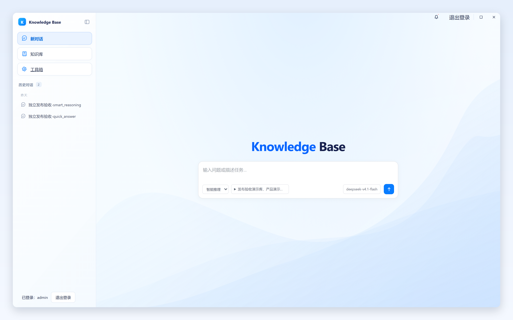

## 功能预览

把产品手册、服务规范和操作清单放入知识库，先检索相关内容，再让智能助手读取原文、对照多份资料并给出带来源的回答。适合需要反复查资料、整理规范和核对依据的文档问答场景。

| 能力 | 可以完成的操作 |
| --- | --- |
| 知识库与文档 | 新建知识库，批量上传 Markdown / TXT，查看处理状态，下载原文件、重新索引 |
| 自动切片 | 按文档结构组织片段，保留标题层级与原文行号，建立向量索引 |
| 语义检索 | 在指定知识库内查找片段，查看相似度、来源文档和原文范围 |
| 快速问答 | 在选定知识范围内检索并流式回答，附带可打开的来源卡片 |
| 智能推理 | 通过多轮工具调用检索、读取并综合资料，展示工具步骤与引用结果 |
| 会话与来源 | 恢复历史会话，从回答中的来源卡片打开原文片段 |
| Skills | 查看技能目录、启停技能、刷新目录，按需加载技能正文与文本资源 |
| 工具扩展 | 配置 MCP 服务、发现工具并管理工具白名单 |

## 操作演示

以下围绕仓库内的[演示资料](examples/documents)展开：产品指南、服务响应、上线检查、访问规范与归档政策。完整流程是 **创建知识库 → 上传文档 → 等待索引 → 检索片段 → 智能推理 → 核对来源**。

### 1. 创建知识库，确定资料范围

从左侧「知识库」进入列表，点击「新建知识库」，填写名称与描述。不同主题的资料可放入不同知识库，在对话时勾选需要使用的范围。

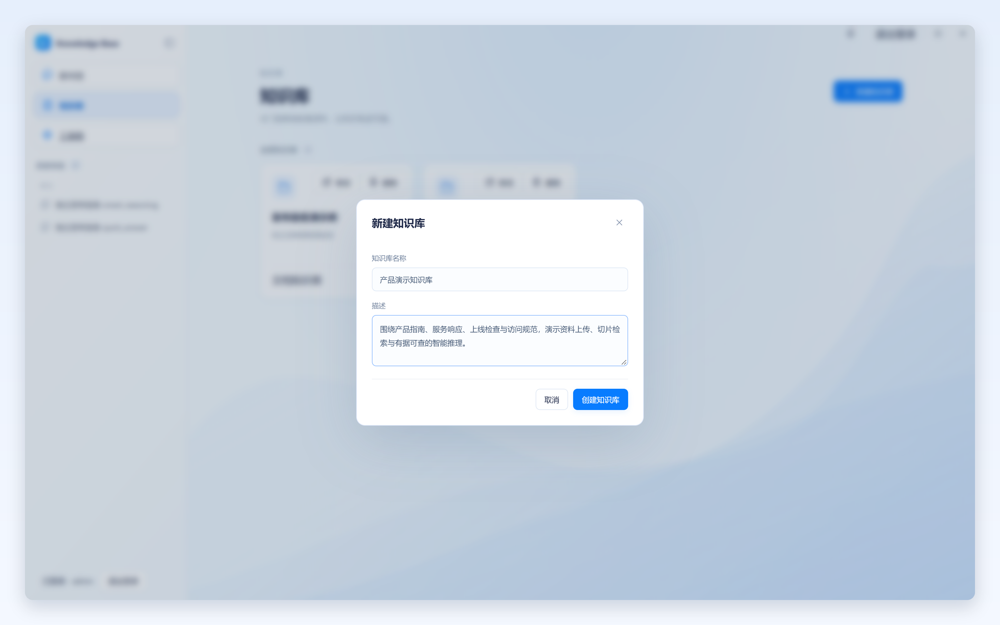

### 2. 批量上传文档

进入知识库后点击「上传文档」，选择目标知识库，拖拽文件或多选文件后提交。当前上传入口支持 **UTF-8 / UTF-8 BOM 编码的 `.md`、`.txt` 文件，单个文件最多 20 MiB**。

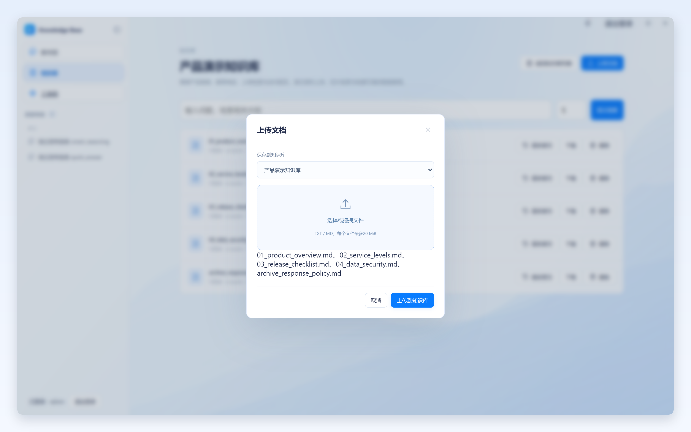

上传后，后台 worker 完成解析、切分和向量索引。文档列表展示处理结果；显示「可检索」后，即可参与检索和问答。列表同时提供重新索引、下载和删除入口，处理失败时可重试。

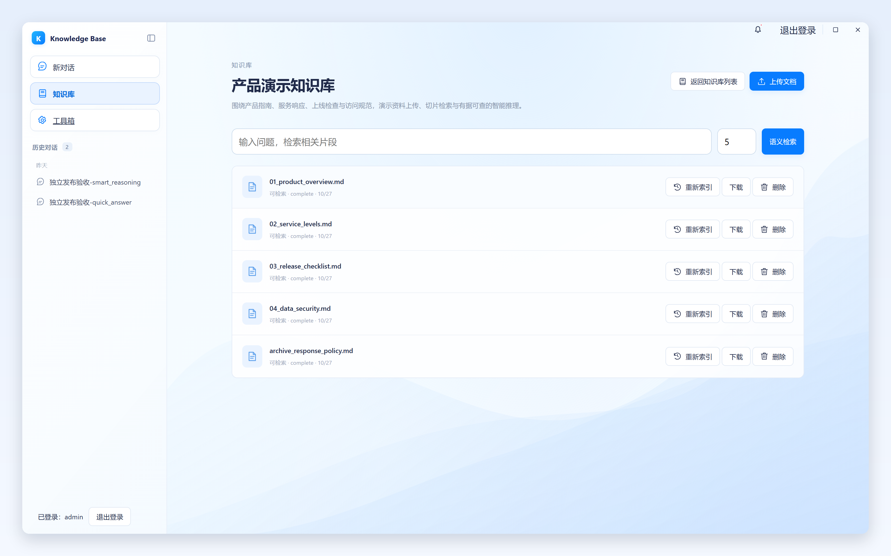

### 3. 检索并查看切片

在知识库详情页输入问题并点击「语义检索」。结果直接展示相关片段，包含来源文件、标题路径、原文行号与 COSINE 相似度，也可下载原文件进行对照。

例如输入：

```text
P1 故障的首次响应、进展同步和升级通知要求是什么？
```

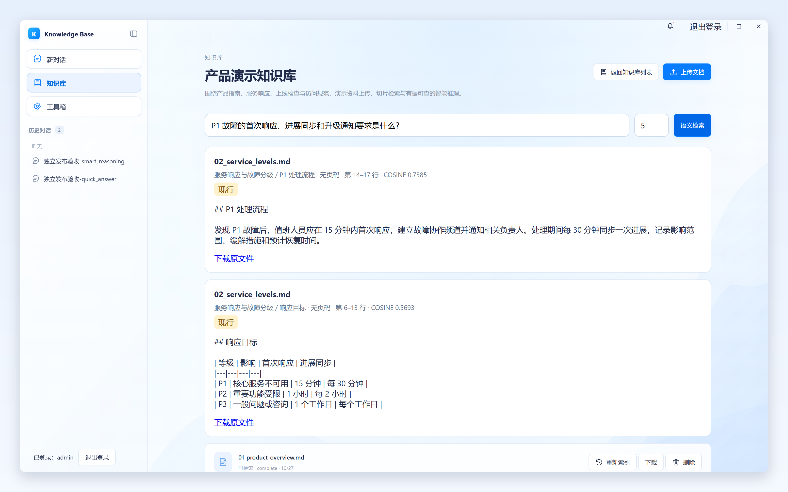

切片在入库阶段自动生成，默认 `CHUNK_SIZE=512`、`CHUNK_OVERLAP=80`，处理时结合标题分节，并保护代码、公式和表格边界。这个页面用于检索和查看片段；切片内容随文档重新索引更新。

### 4. 让智能推理对照多份资料

点击「新对话」，选择「智能推理」与演示知识库，输入需要综合资料的问题：

```text
结合《知识库上线检查清单》和《数据安全与访问规范》，整理知识库对外发布前的检查项。
请先检索并读取两份原文，用简洁表格区分必须项与建议项，给出来源。
```

智能推理使用原生 ReAct Agent，根据任务调用 `search_knowledge`、`read_document` 等工具。界面逐步展示工具名称、调用次数与返回数量，便于查看资料是如何被找到和读取的。

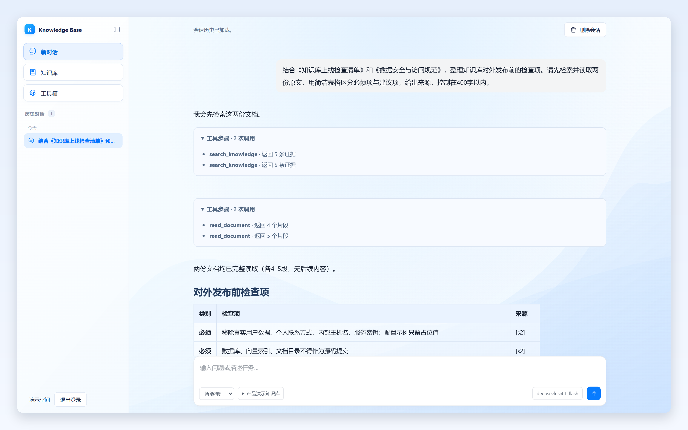

对话检索采用 BM25 与向量双路召回，经 RRF 融合和 Rerank 重排后组织证据。智能推理可继续读取文档，综合多个来源，输出带引用的 Markdown、列表或表格。

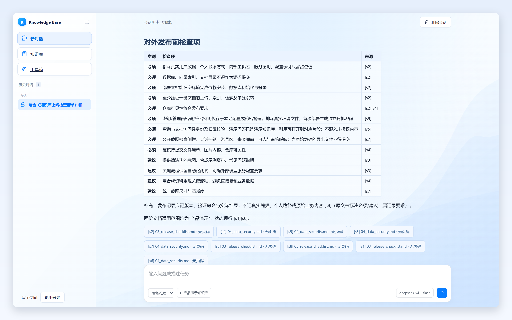

需要直接查询单个事实时，也可选择「快速问答」，例如询问 P1 故障的首次响应目标。两种模式都可限定知识库范围，并保留回答与来源。

### 5. 打开来源，核对回答

点击回答下方的来源卡片，打开对应文档的原文片段与行号，将结论和依据放在一起核对。历史会话可重新打开，继续查看已保存的回答、工具步骤和来源。

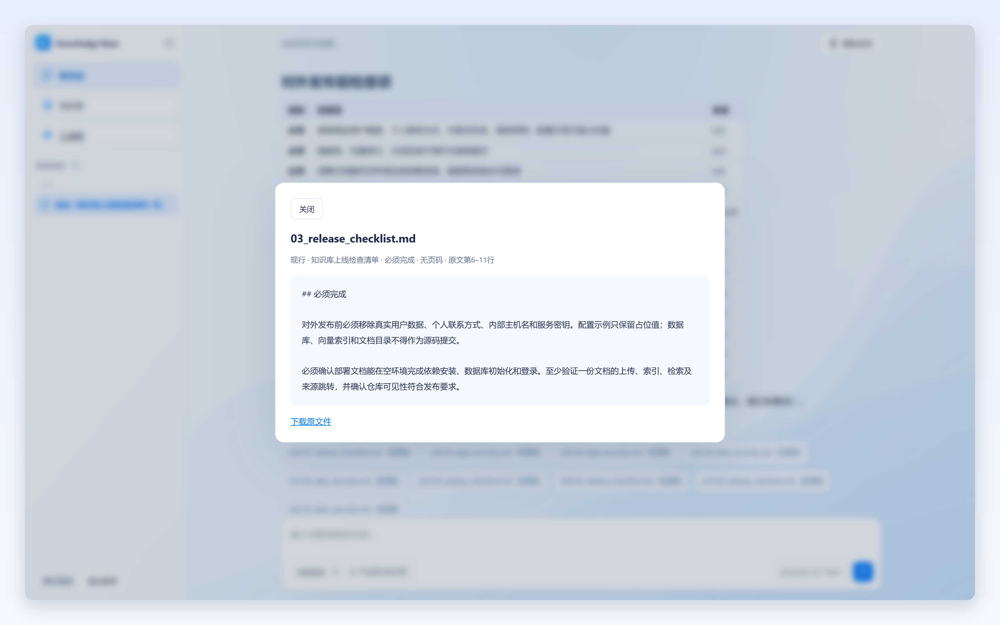

## Skills管理与加载

Skills 将任务方法写成可加载的技能说明与参考资料。点击左侧「工具箱」进入「技能管理」，查看技能名称、说明、启用状态和资源数量。

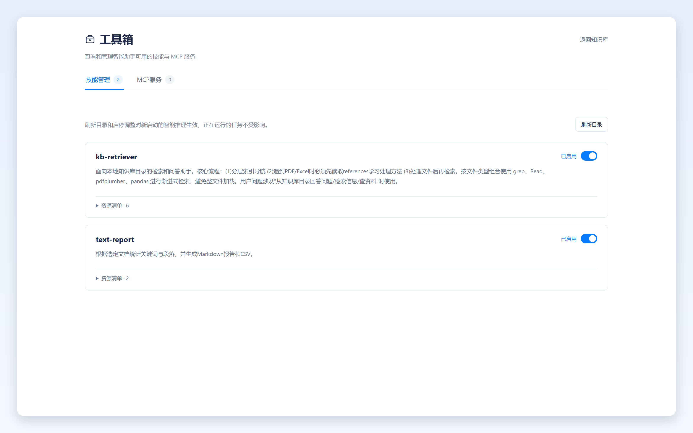

### 启停技能与刷新目录

点击技能右侧开关即可启用或停用；修改技能目录后，点击「刷新目录」重新读取。调整对**新启动的智能推理**生效，正在运行的任务继续使用启动时的技能快照。

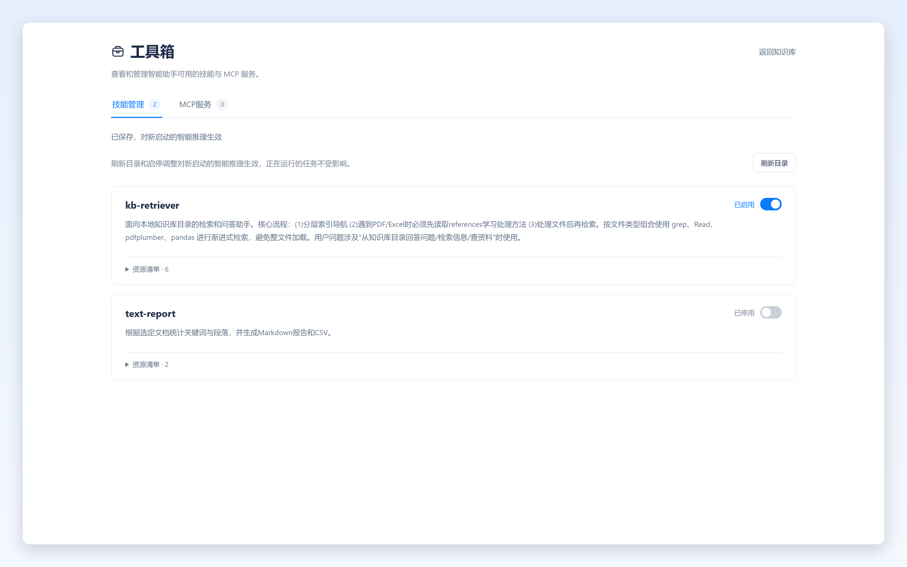

### 展开资源清单

点击「资源清单」，查看技能附带的参考文档与脚本条目。技能以 `SKILL.md` 描述用途，文本资源可在推理过程中按需读取。

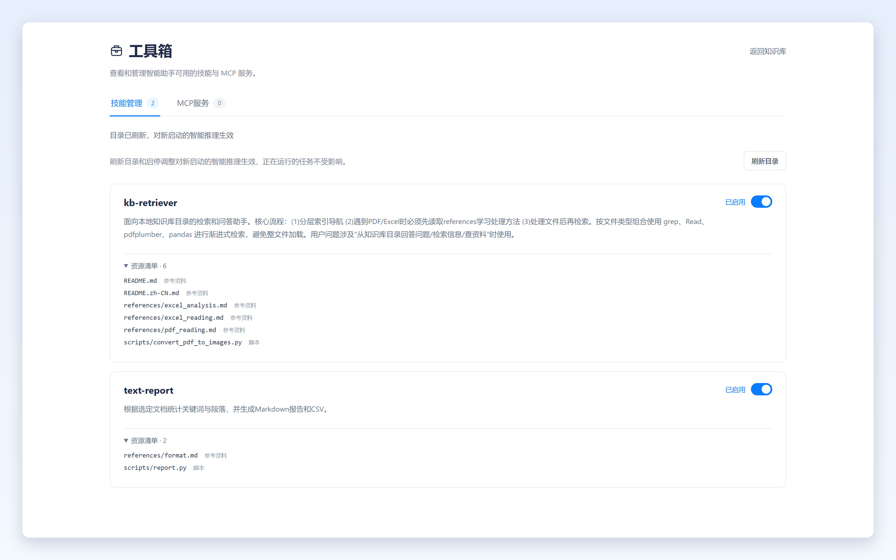

当前实现提供目录管理、技能正文加载和已登记文本资源读取。资源清单中的脚本条目用于登记与展示，当前推理工具不提供脚本执行能力。

### 在智能推理中加载技能

新建一次智能推理，输入：

```text
请列出已启用技能，加载 text-report，再读取 references/format.md，
最后用三条要点概括输入格式、统计口径和产物约定。只解释已读取的规范。
```

助手依次调用 `list_skills`、`load_skill`、`read_skill_resource`，读取说明后回答。工具步骤保留在会话中，可检查本次使用了哪些技能资源。

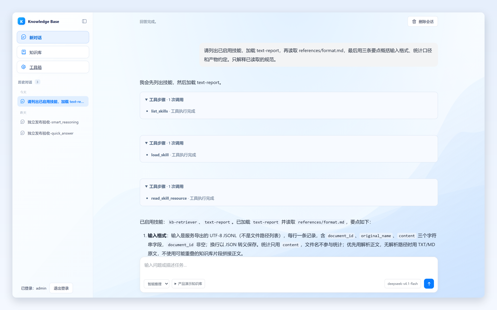

## 架构

前端由 FastAPI 同源提供，使用原生 HTML / CSS / JavaScript，无需单独构建。API 负责鉴权、知识库、检索和会话；一个 RQ worker 处理异步入库任务。

```text
浏览器工作台
    │
FastAPI ── 登录 / 知识库 / 文档 / 会话
    ├── 入库队列 ── Redis / RQ worker ── 解析、切片、向量化
    ├── 检索管线 ── BM25 + Milvus ── RRF / Rerank
    ├── 智能推理 ── 检索、原文阅读、Skills、MCP 工具
    ├── MySQL ──── 文档元数据、会话与迁移记录
    └── Langfuse ── 调用追踪与观测
```

聊天、向量与重排服务通过配置接入；向量存储使用 **Milvus 2.6.22**，客户端锁定在同一 2.6 版本系列。

## 快速开始

推荐 Linux / WSL，准备 **Python 3.12、Docker Engine、Docker Compose v2**。以下命令在仓库根目录执行。

### 1. 安装依赖并生成配置

```bash
python3.12 -m venv .venv
.venv/bin/python -m pip install -r requirements.lock
bash scripts/gen-secrets.sh
```

脚本生成本地 `.env` 和 `.env.langfuse`，写入随机管理员、数据库与观测服务凭据。编辑 `.env`，配置实际使用的模型服务：

| 服务 | 必填配置 |
| --- | --- |
| 聊天模型 | `CHAT_BASE_URL`、`CHAT_API_KEY`、`CHAT_MODEL`，模型需支持工具调用 |
| 向量模型 | `EMBED_BASE_URL`、`EMBED_API_KEY`、`EMBED_MODEL`、`EMBED_DIMENSION` |
| 重排模型 | `RERANK_URL`、`RERANK_API_KEY`、`RERANK_MODEL`，URL 使用完整重排端点 |

向量维度应与服务实际输出一致。完整配置模板见 [.env.example](.env.example)，本地环境文件已被 Git 忽略。

### 2. 启动服务

```bash
bash scripts/start_kb.sh
```

启动脚本依次拉起业务依赖与 Langfuse、执行数据库迁移，再启动**一个 worker** 和 API。首次启动初始化空数据库及管理员。

打开 `http://127.0.0.1:8000`，使用 `.env` 中的 `ADMIN_USERNAME`、`ADMIN_PASSWORD` 登录。新建知识库，上传 [examples/documents](examples/documents) 中的文件，等待「可检索」后按上面的流程体验。

### 3. 配置与运行说明

- `APP_ORIGIN` 与浏览器访问地址保持一致；本机 HTTP 使用 `COOKIE_SECURE=false`，HTTPS 部署设为 `true`。
- `COMPOSE_PROJECT_NAME` 与 `LANGFUSE_COMPOSE_PROJECT_NAME` 用于隔离多份部署；同机运行时还需同步调整宿主端口。
- 迁移支持空数据库或已有 Alembic 版本记录的数据库；非空且无迁移记录的数据库会拒绝接管。
- `SKILL_DIRS` 配置技能扫描目录；默认扫描仓库 `skills/`。

停止方式、端口、迁移和观测配置见[部署与开发文档](docs/deployment.md)。

## 开发与验证

```bash
# 离线后端测试，使用合成资料
.venv/bin/python -m pytest -q tests

# 前端语法与交互测试，Node.js 22+
node --check frontend/app.js
node --check frontend/quick-answer.js
node --test tests/test_frontend_chat.cjs tests/test_toolbox_frontend.cjs tests/test_mcp_frontend.cjs
```

发布验证结果与本机演示操作记录见[验证记录](docs/validation.md)。

| 目录 | 内容 |
| --- | --- |
| `app/` | API、Agent、检索与入库管线、数据访问及外部适配 |
| `frontend/` | 页面、样式、交互和本地 Markdown 渲染 |
| `migrations/` | 数据库迁移序列 |
| `infra/` | 本地 Milvus 与 Langfuse 部署配置 |
| `scripts/` | 配置初始化、启动与入库恢复 |
| `skills/` | 技能说明与资源 |
| `examples/` | 合成演示资料 |
| `tests/` | 离线后端与前端交互测试 |

项目说明与界面组织参考 [WeKnora](https://github.com/Tencent/WeKnora)，第三方组件见[第三方声明](THIRD_PARTY_NOTICES.md)。
